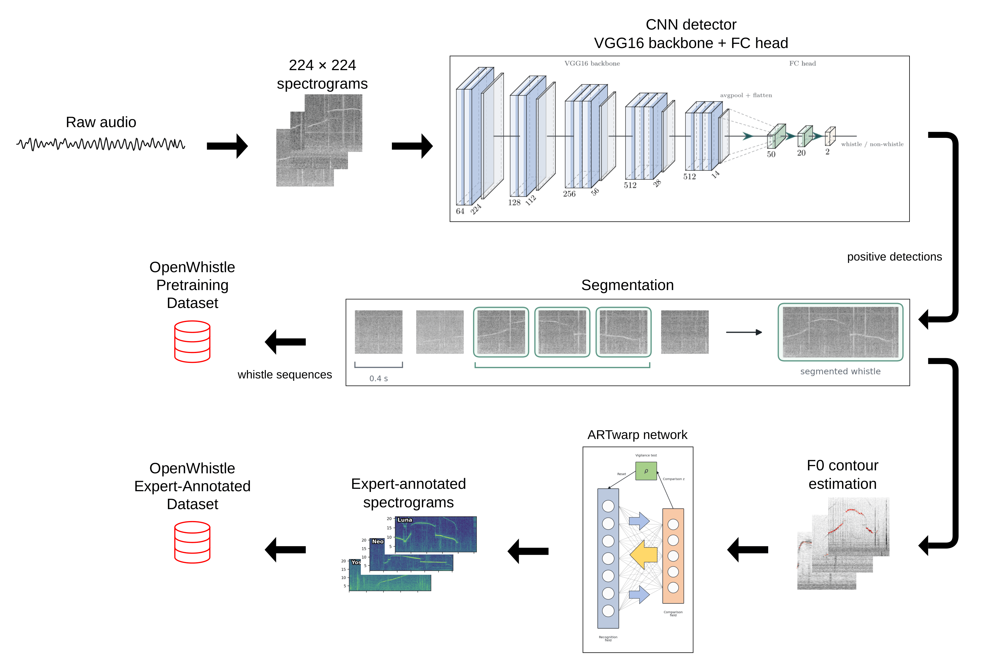

<div align="center">

<h1>🐬 OpenWhistle</h1>

<h3>A Large-Scale Longitudinal Dataset and Benchmark of Bottlenose Dolphin Vocalizations</h3>

<p>
  <a href="https://sumbre-lab.github.io/openwhistle/">🌐 <b>Project Page</b></a> •
  <a href="https://arxiv.org/abs/2609.34839">📄 <b>Paper</b></a> •
  <a href="https://huggingface.co/collections/dolphinteam/neurips26-openwhistle-6a2ac4d02f951a035d8329dd">🤗 <b>Hugging Face</b></a>
</p>

<p><b>NeurIPS 2026 Datasets & Evaluations Track — Spotlight</b></p>

</div>

OpenWhistle is the largest publicly available dataset of bottlenose dolphin vocalizations: approximately **180,000 whistles (114 hours)** recorded over five years from a stable pod of five individuals in a semi-natural environment. It includes **8,354 expert-annotated whistles**, reproducible detection and classification benchmarks, the full processing pipeline, and a wav2vec 2.0 model pretrained specifically on dolphin acoustics.

```bibtex
@misc{mustun2026openwhistle,
  title         = {OpenWhistle: A Large-Scale Longitudinal Dataset and Benchmark of Bottlenose Dolphin Vocalizations},
  author        = {Mustun, Faadil and Semenzin, Chiara and Dessi, Roberto and Robin Guerrero, Pablo and Orhan, Pierre and Emanuelli, Alexis and Rossi, Emanuele and Lakretz, Yair and de Polavieja, Gonzalo and Sumbre, German},
  year          = {2026},
  eprint        = {2609.34839},
  archivePrefix = {arXiv},
  primaryClass  = {cs.CL},
  url           = {https://arxiv.org/abs/2609.34839}
}
```

## News

- **[2026/09]** OpenWhistle was accepted as a **Spotlight** at the NeurIPS 2026 Datasets & Evaluations Track.
- **[2026/09]** We released the OpenWhistle datasets and pretrained models on [Hugging Face](https://huggingface.co/collections/dolphinteam/neurips26-openwhistle-6a2ac4d02f951a035d8329dd).

## Overview

<p align="center">
  
</p>

This repository provides the code to access the data and reproduce the paper experiments. It includes the multi-model benchmark, wav2vec 2.0 pretraining, whistle presence detection and segmentation, and scripts used to generate the dataset figures in the manuscript.

## Hugging Face datasets

| Resource | Hugging Face link |
|----------|-------------------|
| **Pretraining corpus** — long-form unlabeled and weakly processed audio for self-supervised learning | [dolphinteam/OpenWhistle-Pretraining](https://huggingface.co/datasets/dolphinteam/OpenWhistle-Pretraining) |
| **Classification benchmark** — expert-annotated clips and whistle-type labels | [dolphinteam/OpenWhistle-Classification-Finetuning](https://huggingface.co/datasets/dolphinteam/OpenWhistle-Classification-Finetuning) |
| **Detection benchmark** — expert-annotated windows for whistle detection | [dolphinteam/OpenWhistle-Detection-Finetuning](https://huggingface.co/datasets/dolphinteam/OpenWhistle-Detection-Finetuning) |
| **CNN training set** — audio windows, spectrograms, and binary whistle/noise labels | [dolphinteam/OpenWhistle-CNN](https://huggingface.co/datasets/dolphinteam/OpenWhistle-CNN) |

The OpenWhistle datasets are released under **CC BY 4.0**.

## Hugging Face models

| Model | Task | Hugging Face link |
|-------|------|-------------------|
| **OpenWhistle wav2vec 2.0** | Self-supervised acoustic representation learning and downstream feature extraction | [dolphinteam/OpenWhistle-Wav2Vec2.0](https://huggingface.co/dolphinteam/OpenWhistle-Wav2Vec2.0) |
| **OpenWhistle CNN VGG16** | Binary whistle/noise classification from spectrogram windows | [dolphinteam/OpenWhistle-CNN-VGG16](https://huggingface.co/dolphinteam/OpenWhistle-CNN-VGG16) |

## Repository layout

Each experiment directory has its own README with installation instructions,
commands and protocols. The [benchmark README](experiments/benchmark/README.md)
describes the linear probing evaluation and generated tables.

```text
.
├── cnn/                         # whistle detection, segmentation and inference
│   ├── utils/
│   ├── analysis/                # audio-derived SNR figure
│   ├── external/                # WMMSD/DCLDE inference tools
│   └── learning_curve/          # training-set size experiment and results
├── datasets_figures/            # dataset overview figures
├── experiments/
│   ├── pretraining/
│   │   └── src/                 # data preparation, native training and export
│   ├── benchmark/
│   │   ├── src/                 # frozen embeddings and logistic regression
│   │   └── results/             # published scores and tables
│   └── finetuning/
│       ├── scripts/             # experiment launchers
│       ├── src/                 # supervised encoder training
│       └── results/             # manuscript results by model and seed
├── tests/
├── Annotation_Pipeline.png
├── LICENSE-DATA
└── README.md
```

- [`experiments/benchmark/`](experiments/benchmark/) reproduces the paper benchmark on the classification and detection datasets.
- [`experiments/pretraining/`](experiments/pretraining/) contains the large-scale self-supervised pretraining material.
- [`cnn/`](cnn/) contains the VGG16-based whistle presence detection and segmentation workflow. See the [CNN README](cnn/README.md) for setup, training, and inference.
- [`datasets_figures/`](datasets_figures/) builds the dataset overview figures used in the manuscript.

## Running the benchmark

The linear probing benchmark evaluates nine frozen representations with logistic
regression on fixed classification and detection splits. C is selected on
validation, and the final probe is fitted on train + validation. The published
protocol uses **batch size 1, FP32, and 1,000 test bootstrap resamples**. The
wav2vec 2.0 checkpoint is `dolphinteam/OpenWhistle-Wav2Vec2.0`.

Install the benchmark dependencies in a Python 3.13 environment, then run from
the repository root:

```bash
python -m pip install -r experiments/benchmark/requirements.txt
python experiments/benchmark/src/run_benchmark.py \
  --output_dir runs/benchmark/reproduction
```

To evaluate only wav2vec 2.0 on balanced classification:

```bash
python experiments/benchmark/src/train_lr_splits.py \
  --model hf \
  --hf_model_id dolphinteam/OpenWhistle-Wav2Vec2.0 \
  --hf_sample_rate 44100 \
  --dataset_name classification \
  --dataset_config balanced
```

The single-run defaults use batch size 1, FP32, feature standardization, seed 42
and 1,000 bootstrap resamples. Its CSV is saved to
`runs/benchmark/single-model/results.csv`.

Install compatible `torch` and `torchaudio` builds for your CPU or CUDA setup.
The [benchmark README](experiments/benchmark/README.md) documents the exact
protocol, pinned model/dataset revisions, resume options and table generation.
Use `--dry_run` to inspect the 27 evaluation commands and one table generation
command without downloading or writing files.

The [published main table](experiments/benchmark/results/tables/benchmark_all.pdf),
[full results](experiments/benchmark/results/results.csv), and
[evaluation protocol](experiments/benchmark/README.md#evaluation-protocol) are
included in the repository. Prediction and label arrays remain in local runs.
New evaluations and embedding caches go under
ignored `runs/benchmark/` at the repository root. For the binary whistle/noise
CNN, use [`cnn/`](cnn/) instead of the representation benchmark.

## Additional experiments

The rebuttal additions include pretraining-size ablations, supervised encoder fine-tuning, open-set evaluation, CNN learning curves, and ROC/UMAP figures. See the [benchmark README](experiments/benchmark/README.md), [fine-tuning README](experiments/finetuning/README.md), and [CNN learning-curve README](cnn/learning_curve/README.md) for commands.

## Authors

Faadil Mustun, Chiara Semenzin, Roberto Dessi, Pablo Robin Guerrero, Pierre Orhan, Alexis Emanuelli, Emanuele Rossi, Yair Lakretz, Gonzalo de Polavieja, and German Sumbre.
