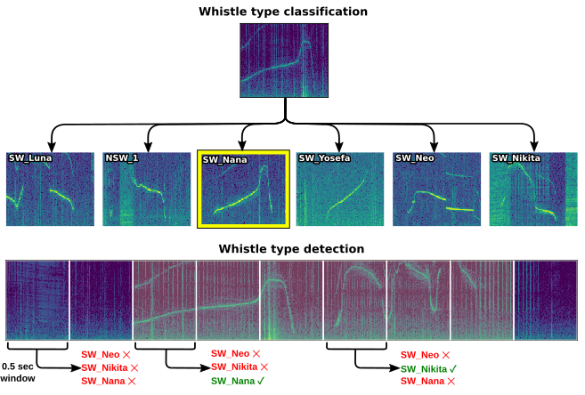

# OpenWhistle: Linear Probing

Code and results for evaluating acoustic representations on OpenWhistle
whistle-type classification and multilabel detection. We compare nine
representations, from classical acoustic features to pretrained audio encoders,
by fitting logistic regression probes while keeping the representations fixed.

<p align="center">
  
</p>

[Results](#results) · [Installation](#installation) · [Evaluation](#evaluation) ·
[Protocol](#evaluation-protocol) · [Models](#representations)

## Results

Classification is evaluated with **macro-F1** and detection with **mAP**.
Scores are percentages, reported as the full-test metric ± the standard
deviation over 1,000 bootstrap resamples. Best scores in each column are bold.

| Representation | Classification (`all`) | Classification (`balanced`) | Detection |
|---|---:|---:|---:|
| Spectral features | 14.15 ± 0.67 | 33.52 ± 2.06 | 26.34 ± 1.17 |
| MFCCs | 21.22 ± 0.99 | 44.20 ± 2.20 | 33.91 ± 1.77 |
| Mean spectrogram | 32.05 ± 1.30 | 54.95 ± 2.15 | 47.80 ± 2.10 |
| AVES-core | 51.60 ± 2.28 | 67.60 ± 2.11 | 57.39 ± 2.07 |
| BioLingual | 54.03 ± 2.72 | 70.98 ± 2.12 | 66.52 ± 2.23 |
| AVES-bio | 54.45 ± 2.58 | 75.13 ± 1.96 | 65.01 ± 2.29 |
| AVES-bio (from scratch) | 60.97 ± 3.76 | 79.89 ± 1.81 | 76.17 ± 1.97 |
| Wav2Vec2.0 | 61.95 ± 2.79 | **81.40 ± 1.78** | **79.59 ± 1.83** |
| AVES-bio (continual) | **64.75 ± 2.64** | 75.24 ± 2.01 | 73.87 ± 2.06 |

- [Main table: PDF](results/tables/benchmark_all.pdf) · [LaTeX](results/tables/benchmark_all.tex)
- [Balanced classification: PDF](results/tables/benchmark_balanced.pdf) · [LaTeX](results/tables/benchmark_balanced.tex)
- [Overview with all scores and uncertainties](results/tables/benchmark_overview.md)
- [Full-precision CSV](results/results.csv)

## Installation

Use Python 3.13 and install from the repository root:

```bash
python -m pip install -r experiments/benchmark/requirements.txt
```

Install compatible `torch` and `torchaudio` wheels for your CPU/CUDA setup.
The reference evaluation used Python 3.13.9, PyTorch `2.12.1+cu130`, TorchAudio
`2.11.0+cu130` and CUDA 13.0. Other direct dependencies are pinned in
[requirements.txt](requirements.txt). The runner records the environment of
each local run and checks it before resuming.

Audio is decoded with SoundFile; native AVES models use `esp-aves`.

## Evaluation

Run all commands from the repository root.

### Full benchmark

Evaluate all nine representations on classification `all`, classification
`balanced` and detection:

```bash
python experiments/benchmark/src/run_benchmark.py \
  --output_dir runs/benchmark/reproduction
```

This produces 27 evaluations, `results.csv`, predictions, split labels and
Markdown/LaTeX tables in the chosen run directory. Embeddings are cached under
`runs/benchmark/embedding_cache/`.

Add `--resume` to continue an interrupted run, or `--dry_run` to print the
27 evaluation commands and one table command without running them.
`--embedding_cache_dir` changes the shared cache directory. Without
`--output_dir`, a new directory is created at
`runs/benchmark/run-YYYYMMDD-HHMMSS/`. The runner checks run settings and the
numerical environment before resuming. Local run files are ignored by Git;
[results/](results/) contains the published scores and tables.

### Single evaluation

Example: Wav2Vec2.0 on balanced classification.

```bash
python experiments/benchmark/src/train_lr_splits.py \
  --model hf \
  --hf_model_id dolphinteam/OpenWhistle-Wav2Vec2.0 \
  --hf_sample_rate 44100 \
  --dataset_name classification \
  --dataset_config balanced
```

Batch size 1, FP32, feature standardization, seed 42 and 1,000 bootstrap
resamples are already the defaults. Results are saved to
`runs/benchmark/single-model/results.csv`; `--results_csv` changes that path.
Add `--embedding_cache_dir runs/benchmark/embedding_cache` to reuse or save
embeddings. Use `train_lr_splits.py --help` for other representations and options.

### Regenerate the published tables

Regenerate Markdown and LaTeX tables from the published CSV without loading
audio or models:

```bash
python experiments/benchmark/src/build_tables.py \
  --run_dir experiments/benchmark/results \
  --output_dir runs/benchmark/paper-tables
```

Add `--pdf` for `pdflatex`, or `--pdf --tectonic_bin /path/to/tectonic`.
For a new evaluation, set `--run_dir` to its run directory. Scores and
uncertainties are rounded to two decimal places from the full-precision CSV.

## Evaluation protocol

| Task | Hugging Face dataset | Configuration | Metric |
|---|---|---|---|
| Classification | `dolphinteam/OpenWhistle-Classification-Finetuning` | `all` (10 classes), `balanced` (6) | Macro-F1 |
| Detection | `dolphinteam/OpenWhistle-Detection-Finetuning` | `default` (7 labels) | Macro-averaged AP |

The protocol uses **batch size 1, FP32, seed 42 and 1,000 bootstrap resamples**.
The official train/validation/test splits are fixed. Select C from `{0.1, 1, 10}`
by validation performance, fitting StandardScaler on train only. Refit the
scaler and final probe on train + validation. Classification uses multiclass
logistic regression; detection fits one logistic regression per label. Both use
`lbfgs`, `max_iter=20000`, default tolerance and no class weighting.

The point estimate is the metric on the full test split. The ± value is the
sample standard deviation (`ddof=1`) of 1,000 unstratified test-clip resamples
with replacement, using NumPy `default_rng(42)`. One fitted probe supplies all
resamples. This measures test-sampling uncertainty, not encoder-training
variability. Detection uses the released Torch rank-based AP definition,
including its treatment of tied scores and labels without positives.

Chance macro-F1 is the expectation under a random permutation of test labels
preserving class counts (`1/K`). Detection chance is the expected finite-test
mAP under independent continuous random scores: 7.84% for the published split.
The input counts are defined in `src/benchmark_config.py`.

## Representations

| Representation | Encoder or feature extractor |
|---|---|
| Spectral features | Mean spectral centroid, bandwidth, contrast and rolloff |
| MFCCs | Mean of 13 MFCCs |
| Mean spectrogram | Mean log-mel spectrogram, 128 mel bins |
| AVES-core / AVES-bio | Official TorchAudio AVES encoders at 44.1 kHz |
| BioLingual | `davidrrobinson/biolingual`, native CLAP frontend at 48 kHz |
| AVES-bio (from scratch) | `dolphinteam/AVES-OpenWhistle-Stage-2-320-100pct`, native 44.1 kHz |
| Wav2Vec2.0 | `dolphinteam/OpenWhistle-Wav2Vec2.0`, native 44.1 kHz |
| AVES-bio (continual) | `dolphinteam/AVES-bio-OpenWhistle-100pct-44kHz`, three 16 kHz band views |

Model and dataset snapshots are pinned in
[benchmark_revisions.py](src/benchmark_revisions.py). Native AVES artifact
paths, revisions and SHA-256 hashes are defined in
[aves_models.py](src/aves_models.py). Wav2Vec2.0 uses the native Fairseq checkpoint
at 400,000 updates. Its training recipe is documented in
[pretraining/](../pretraining/README.md).

Continual AVES uses BTB3: baseband and two frequency-shifted views of the original
44.1 kHz waveform, encoded at 16 kHz and concatenated into 2,304 features.
Wav2Vec2.0 and AVES pool valid output frames; BioLingual uses native pooling.
Extraction uses batch size 1 and FP32 with AMP disabled; the CUDA path permits
TF32. Embedding caches include a fingerprint of extraction code and dependency
versions to invalidate outdated features automatically.
